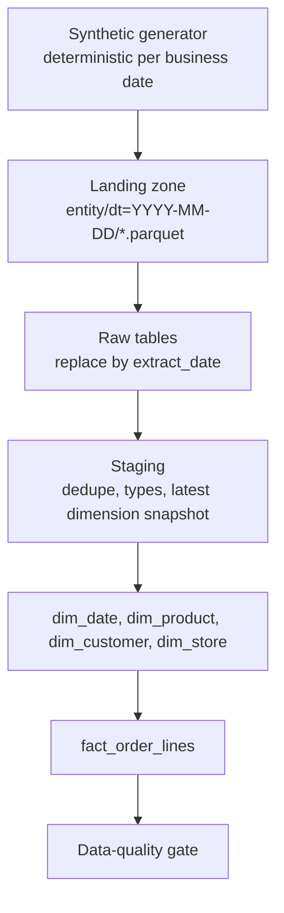
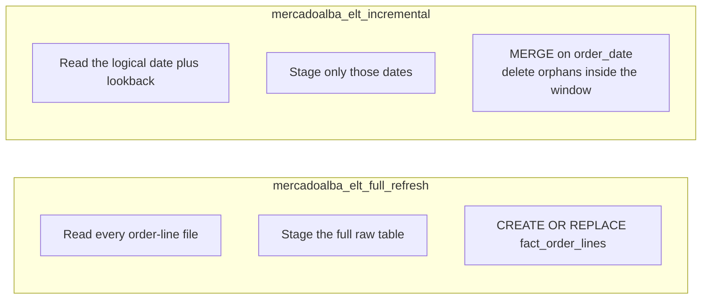
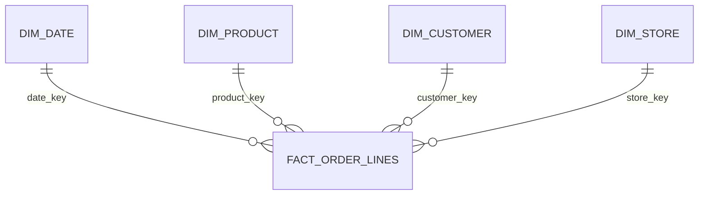

# Mercado Alba ELT

Site: https://eflores1122.github.io/airflow-bigquery-retail-elt/

Reference Airflow ELT for **Mercado Alba**, a fictitious Mexican omnichannel retailer. The pipeline lands synthetic online and in-store orders, order lines, products, customers, stores, and daily inventory snapshots, then publishes a star schema:

`fact_order_lines`, `dim_product`, `dim_customer`, `dim_store`, `dim_date`.

This repository is a reference implementation built with synthetic data. It demonstrates techniques Edgar Flores uses: incremental `MERGE` on partitions, idempotent backfills, and data-quality checks.

Mercado Alba is not a real company. Every order, product, customer, store, and inventory row is generated locally. The timings below are local synthetic runs on this dataset and this machine.

## Tech stack

- Python 3.11 or 3.12
- Apache Airflow 2.10.5 TaskFlow DAGs
- DuckDB 2.x as the local warehouse used by the CLI, tests, and CI
- BigQuery as an optional adapter that runs the same `MERGE` text
- Parquet landing files written with PyArrow
- pytest and ruff
- A Vite page that runs the shared SQL in DuckDB-WASM

## What runs locally

No GCP project and no credentials are required.

| Piece | Local / CI | Production-shaped target |
| --- | --- | --- |
| Orchestration | Airflow TaskFlow DAGs, exercised by parse tests | The same DAGs |
| Landing | `entity/dt=YYYY-MM-DD/part-000.parquet` on disk | The same relative paths under a `gs://` prefix |
| Warehouse | DuckDB file | BigQuery, optional extra |
| Fact layout | Indexes on `order_date`, `store_id`, `product_id` | `PARTITION BY order_date` and `CLUSTER BY store_id, product_id` |
| Publish SQL | One `MERGE` for the incremental path | The same `MERGE` text, with quoted table names |

Staging SQL, dimension sync, the fact `MERGE`, and the data-quality queries are shared. DDL is where the engines diverge: BigQuery gets partition and cluster clauses; DuckDB gets secondary indexes on the same columns. Those indexes are an access-path stand-in, not the same storage layout as BigQuery clustering.

## Architecture







Daily inventory is landed, staged, and checked (uniqueness, non-negative units, and foreign keys to store and product). It stays out of the sales star. Each inventory file is a synthetic snapshot, not a reconstructed stock ledger.

Business dates are America/Mexico_City civil dates. Timestamps in the files are naive UTC. Mexico has observed UTC−6 without daylight saving for this calendar range.

## Two publish strategies

**Full refresh** (the naive path). Each run reloads every landed partition and rebuilds `fact_order_lines` with `CREATE OR REPLACE`. Cost grows with retained history. On BigQuery the recreated table keeps `PARTITION BY` and `CLUSTER BY`. On DuckDB the rewrite drops secondary indexes, and the task creates them again.

**Incremental** (the partitioned path). Each run reads the logical date and a lookback (the scheduled DAG uses one day) and `MERGE`s that window:

- matched rows update
- new rows insert
- `WHEN NOT MATCHED BY SOURCE AND order_date BETWEEN ... THEN DELETE` removes rows that disappeared inside the window
- rows outside the window stay

The date predicate is what lets BigQuery prune `PARTITION BY order_date`. DuckDB runs the same statement and uses the date index. Re-running a date is idempotent: the same seed rewrites the same parquet, and the merge does not duplicate `order_line_id`.

Dimensions are SCD Type 1. The incremental path merges the latest product, customer, and store snapshots and deletes keys that left the snapshot. Attributes in this generator are stable across days, so a backfill resolves current dimension rows.

A missing lookback partition is skipped. The logical date itself is required. Skipping the gap matters: a merge window that included an absent day would delete that day from the fact.

## Benchmark

<!-- BENCHMARK:START -->

Measured on Linux-6.12.94+-x86_64-with-glibc2.39, Python 3.12.3, DuckDB 2.0.0, 4 CPUs. Median of 3 runs after 1 warmup. Generation is excluded. Parquet stays in the OS page cache after warmup, which favors the full refresh. Each full-refresh sample starts from an empty DuckDB file. Each incremental sample starts from a copy of a warehouse that already holds every day.

| Scenario | Median total (s) | Median load + stage (s) | Median publish (s) | Median quality (s) | Order-line files |
| --- | ---: | ---: | ---: | ---: | ---: |
| Full refresh of 21 days | 4.550 | 2.606 | 1.805 | 0.109 | 21 |
| Incremental, lookback 0 (one partition) | 1.450 | 0.189 | 1.072 | 0.073 | 1 |
| Incremental, lookback 1 (scheduled DAG) | 3.463 | 0.571 | 1.932 | 0.082 | 2 |
| Incremental backfill of 21 days (one sample) | 21.108 | 8.510 | 8.585 | 1.107 | 21 |

Dataset: 1,215,000 fact rows across 21 daily partitions, 1,000 products, 20 stores, 8,000 customers, seed 42. Weekday volume makes some days larger than `--order-lines-per-day`.

Steady-state ratio of median total time, full refresh / one-partition incremental: **3.14x**. Full refresh / scheduled lookback-1 incremental: **1.31x**. The same ratios for load+stage+publish, excluding quality gates, are **3.50x** and **1.76x**. The backfill row is one pass that applies every partition from an empty warehouse. A cold historical load can be cheaper as a single full refresh. The daily win is the steady-state merge, whose cost stays tied to the window rather than to retained history.

These figures are local synthetic runs only. They describe this DuckDB dataset on this machine.

<!-- BENCHMARK:END -->

`scripts/benchmark.py` writes `benchmarks/results.json` and refreshes the block above. Tests check that the README quotes those medians. CI does not re-time the benchmark; it checks the artifact.

## Data-quality gate

The quality task fails the DAG when any check returns a non-zero violation count.

- `order_line_id` is unique across the whole fact, not only the window
- required fact columns are non-null
- sales have positive quantity and line amount; returns have negative quantity and line amount
- line amount equals quantity times unit price, and `amount_mxn` matches centavos
- fact rows reference `dim_product`, `dim_customer`, `dim_store`, and `dim_date`
- category matches the product, and channel matches the store
- staged order lines equal fact rows for the published window
- the fact contains the logical date
- product, customer, and store natural keys are unique
- inventory rows are unique per store, product, and date, with reserved units not above on-hand units, and both foreign keys resolve
- raw `extract_date` equals the business date

Incremental checks that are about a single batch are limited to the dates just loaded. Global uniqueness is not.

## Idempotency, backfill, retries, SLAs

Landing writes for a date replace `part-000.parquet`. Raw loads delete the `extract_date` values they are about to insert, or truncate the table on a full refresh. Publishing again for the same window does not create a second fact row.

`catchup` is off, so unpausing a DAG does not replay from 2026-01-01. Backfill one day with the `logical_date` param, or from the CLI:

```bash
airflow dags backfill mercadoalba_elt_incremental \
  --start-date 2026-01-05 \
  --end-date 2026-01-11
```

The library does the same thing in a date loop. `max_active_runs` is 1 because a DuckDB file has a single writer.

Airflow retries `publish_marts` and the load task twice with exponential backoff. The quality task retries once: a failed gate is deterministic and will fail again. The library also retries transient warehouse errors inside load and publish (`transform_attempts`, default 3). `DataQualityError` is raised after that retry loop, so the helper does not treat a bad extract as a blip. Set `MERCADOALBA_TRANSFORM_ATTEMPTS=1` when Airflow should be the only retry layer.

Schedule is `0 7 * * *` UTC, which is 01:00 in America/Mexico_City. The data interval start is the business date the batch closes.

| DAG | Task SLA | DAG run timeout |
| --- | --- | --- |
| `mercadoalba_elt_incremental` | 30 minutes on the heavy tasks | 1 hour |
| `mercadoalba_elt_full_refresh` | 2 hours | 3 hours |

These are operational thresholds for this reference project, so a missed budget is visible on the task. They are not measurements. Missed-SLA notifications need an Airflow notifier or SMTP connection, which the local compose file does not configure. Freshness of the data is the quality check, separate from the Airflow SLA.

## Synthetic feed

| Entity | Grain | Notes |
| --- | --- | --- |
| order_lines | one line on an order | `sale` or `return`; `completed` or `cancelled`; channel `online` or `physical` |
| products | full snapshot per day | `Producto Sintetico NNNNN` |
| customers | full snapshot per day | family name `Sintetico######`; email `@sintetico.invalid` |
| stores | full snapshot per day | `Mercado Alba Digital` plus `Tienda Sintetica NNN` |
| daily_inventory | one row per store, product, and day | on-hand and reserved units, not derived from orders |

Volume follows a weekday curve unless you pass `--no-weekday-volume`. The default population is 400 products, 12 stores, 4,000 customers, and 5,000 order lines on a flat day. Names, products, and stores are generated. None of them are real shoppers or shops.

`dim_date` covers 2024-01-01 through 2028-12-31 and flags the recurring Mexican public rest days (1 January, first Monday of February, third Monday of March, 1 May, 16 September, third Monday of November, 25 December). One-off civic dates are omitted.

## Layout

```
dags/                  TaskFlow DAGs (full refresh and incremental)
src/mercadoalba/       generator, landing, SQL, DuckDB and BigQuery adapters, quality
scripts/benchmark.py   local timing run
scripts/export_browser_sample.py
                       reduced extract and SQL bundle for the site
site/                  browser ELT (DuckDB-WASM), source for GitHub Pages
tests/                 DAG parse tests and transformation tests
docker-compose.yml     optional Airflow 2.10.5, not used by tests
```

## Run it

Python 3.11 or 3.12. Airflow 2.10.5 does not support 3.13. The local warehouse does not need a GCP project, a service account, or `google-cloud-bigquery`. The CLI always opens DuckDB, including when `MERCADOALBA_WAREHOUSE=bigquery` or `GOOGLE_APPLICATION_CREDENTIALS` is set.

```bash
python3.12 -m venv .venv
source .venv/bin/activate
pip install -e .
```

A small local warehouse:

```bash
python -m mercadoalba \
  --mode full-refresh \
  --date 2026-03-02 \
  --history-start 2026-03-01 \
  --order-lines-per-day 2000 \
  --customers 500 \
  --products 40 \
  --stores 4 \
  --no-weekday-volume
```

### Sample output

Row counts below are deterministic for seed 42 and those flags. `timings_seconds` is from one local run and will differ on another machine.

```json
{
  "mode": "full_refresh",
  "logical_date": "2026-03-02",
  "window_start": "2026-03-01",
  "window_end": "2026-03-02",
  "order_line_files_read": 2,
  "staging_order_lines": 4000,
  "fact_order_lines": 4000,
  "fact_rows_in_window": 4000,
  "dim_products": 40,
  "dim_customers": 500,
  "dim_stores": 4,
  "quality_passed": true,
  "timings_seconds": {
    "generate": 0.046516,
    "load_and_stage": 0.119493,
    "publish": 0.194921,
    "quality": 0.019085,
    "total": 0.409408
  }
}
```

### Lint and tests

Tests parse the DAGs, so they need Airflow. Install it from the constraint file that matches the interpreter, then install the dev extra. The constraint file pins DuckDB 1.1.3, which has no `MERGE`. The second command upgrades DuckDB to 2.x, which is what the fact `MERGE` runs on. `make install` selects `constraints-3.11.txt` or `constraints-3.12.txt` from the interpreter version. No Docker and no credentials:

```bash
pip install "apache-airflow==2.10.5" \
  --constraint "https://raw.githubusercontent.com/apache/airflow/constraints-2.10.5/constraints-3.12.txt"
pip install -e ".[dev]"
ruff check .
ruff format --check .
pytest
```

Incremental for one day already on disk:

```bash
python -m mercadoalba \
  --mode incremental \
  --date 2026-03-02 \
  --lookback-days 0 \
  --skip-generate
```

`--history-start` applies to full refresh generation. Incremental generation uses `--lookback-days` ending at `--date`.

Record timings and refresh the benchmark section:

```bash
python scripts/benchmark.py
```

Flags: `--days`, `--order-lines-per-day`, `--products`, `--stores`, `--iterations`, `--warmup`, `--no-readme`.

### Optional Airflow

Tests do not start this stack. The Compose web user and password are `airflow` / `airflow`, and Postgres uses the same pair. Those credentials are local demo defaults only.

Compose does not contain a Fernet key. Generate one and store it in `.env` as `AIRFLOW_FERNET_KEY`. `docker-compose.yml` sets `AIRFLOW__CORE__FERNET_KEY` from `${AIRFLOW_FERNET_KEY:-}`.

```bash
python -c "from cryptography.fernet import Fernet; print(Fernet.generate_key().decode())"
cp .env.example .env
# paste the key into AIRFLOW_FERNET_KEY in .env
docker compose build
docker compose up airflow-init
docker compose up airflow-webserver airflow-scheduler
```

`cryptography` is installed with Airflow. A bare interpreter can run the same one-liner after `pip install cryptography`.

Open `http://localhost:8080` with user `airflow` and password `airflow`. Trigger `mercadoalba_elt_incremental`. The DuckDB file and landing files are under `./data`, which is gitignored. DuckDB allows one writer, and `max_active_runs` is already 1.

### Optional BigQuery

```bash
pip install -e ".[bigquery]"
export MERCADOALBA_WAREHOUSE=bigquery
export MERCADOALBA_BQ_PROJECT=your-project
export MERCADOALBA_BQ_DATASET=mercadoalba
export MERCADOALBA_BQ_LOCATION=US
export MERCADOALBA_GCS_LANDING_PREFIX=gs://your-bucket/mercadoalba
```

The generator still writes local parquet. Sync that tree to the GCS prefix so the relative paths match, then run with generation turned off (`--skip-generate` or DAG param `generate_synthetic=false`). The adapter lists local files and loads the mirrored `gs://` objects. Incremental loads use the partition decorator `table$YYYYMMDD` with `WRITE_TRUNCATE` on that partition. CI never sets these variables and does not install the BigQuery extra.

## Browser site

The GitHub Pages site runs the DuckDB SQL from `sql_builder.py` and `quality.py` in the browser with DuckDB-WASM 1.32.0 (DuckDB 1.4.3). The local warehouse and the benchmark use DuckDB 2.0.0. The statement text is the same DuckDB dialect. The page loads a reduced extract committed under `site/public/sample/`, generated by `scripts/export_browser_sample.py` with seed 42, 12 products, 3 stores, 24 customers, and 40 base order lines per day from 2026-03-02 through 2026-03-06.

A visitor can publish those five partitions one DAG task at a time, replay 6 March, publish 6 March with a one-day lookback, and apply a corrected 4 March file that updates one line and drops another. A separate in-memory database runs the full-refresh `CREATE OR REPLACE` on the original parquet files. Editable SQL runs against the same browser warehouse. The benchmark table reads `benchmarks/results.json`. It is not a timing of the browser extract.

`tests/test_browser_sample.py` reruns the Python pipeline and the exported SQL against that extract. Regenerate the files with:

```bash
python scripts/export_browser_sample.py
```

Pages deploys from `.github/workflows/pages.yml` on a push to `main`. The site does not start Airflow, does not call BigQuery, and does not replay retries or SLAs.

## Limitations

- Mercado Alba is fictitious. Nothing in the landing files is a real shopper, shop, or product, and the pipeline is not a record of a production system.
- CI and the CLI use DuckDB. The BigQuery adapter is optional, is not installed in CI, and is not called unless `MERCADOALBA_WAREHOUSE=bigquery` is set for the DAG path.
- DuckDB secondary indexes stand in for `PARTITION BY order_date` and `CLUSTER BY store_id, product_id`. They are not the same storage layout.
- The browser page uses DuckDB-WASM 1.32.0 (DuckDB 1.4.3). The local warehouse uses DuckDB 2.x. Both execute the DuckDB dialect of the shared SQL.
- `dim_date` flags recurring Mexican public rest days only. One-off civic dates are omitted.
- Daily inventory is landed and checked. It is not part of the sales star, and it is not a stock ledger rebuilt from orders.
- A DuckDB file has one writer. Both DAGs set `max_active_runs` to 1.
- A missed Airflow SLA is visible on the task. This compose file does not configure a notifier or SMTP, so it does not send a message.
- The benchmark table is a local synthetic timing of the committed dataset. It is not a capacity plan.

## License

MIT. See [LICENSE](LICENSE).
